## Watch the walkthrough

<video controls preload="none" playsinline poster="/flow/articles/the-canvas/poster.jpg" aria-label="One brief, three ways, narrated Flow walkthrough" width="1920" height="1080" style="width:100%;height:auto;border-radius:12px">
<source src="/flow/articles/the-canvas/one-brief-three-ways.mp4" type="video/mp4">
Your browser cannot play this video. The full walkthrough follows below.
</video>

*83.5 seconds, with narration. Recorded on review build 0274-3. The canvas now uses Connections or Evidence with a single Grid toggle.*

## What Flow does

**A living document can be driven three ways, and the canvas shows what happened whichever way you chose.**
In Orionfold Flow a document carries its own workflow as Jobs: a saved definition that collects the figures, a watch on the files they come from, a reconcile against the folder, and a draft of one section from named sources. A power user configures each step in the Jobs tab, with the section, the sources, the length and the model in view, and presses Run; every proposal lands in Review Changes. Someone in a hurry types one sentence to Flow Chat, which reads the folder, checks the figures, rewrites the section with a link on every sentence, and starts Flow's heavier actions when asked; every change carries Undo and waits in Review. Either way, the canvas then draws the document in the middle, what it rests on to the left, what it links to below, and what links to it on the right; Evidence shows which file each sentence cites; History lists what the document was derived from and plays its saved versions. In our walk the hand-configured run proposed a section of about twelve hundred words from three sources in just over a minute, and Chat rewrote the section with a citation on every sentence in half that.

## The answer first

1. **Open a living document** such as the Guide's *Client Brief*. The ribbon under the title lists its Jobs as steps, with **Run** at the end.
2. **To configure it yourself**, press a step in the ribbon to open the Workbench on **Jobs**. Set the step's definition, section, sources and length, or press **</>** to read the declaration as text. **Run Jobs**, then decide each proposal in **Review Changes**.
3. **To have Chat do it**, open the Workbench on **Chat** and say what you want: *bring this month's brief up to date from the files in client-files*. Chat changes the document at once with **Undo** on each change, shows the same change in Review, and starts Flow's actions when you ask for them.
4. **To see what happened**, press **Canvas** in the document toolbar (⌥⌘3). **Connections** shows what the document rests on and links to; **Evidence** (⌥⌘4) shows what each sentence cites; the Workbench's **History** tab lists what the document was derived from, and View ▸ **Show History** (⌥⌘Y) plays the saved versions.

## The job

A consultant sends Harbour Analytics a brief every month. The figures come from the client's finance workbook and board deck, imported into a `client-files` folder. The brief has to say what changed, cite where each number came from, and be ready to publish, and next month it has to happen again without starting over. The Guide's *Client Brief* carries that workflow as four Jobs. It also carries an image, three cards, a revenue chart and a table bound to the figures, so the walk is on a document that looks like real work.

## Level one: the Jobs, configured by hand

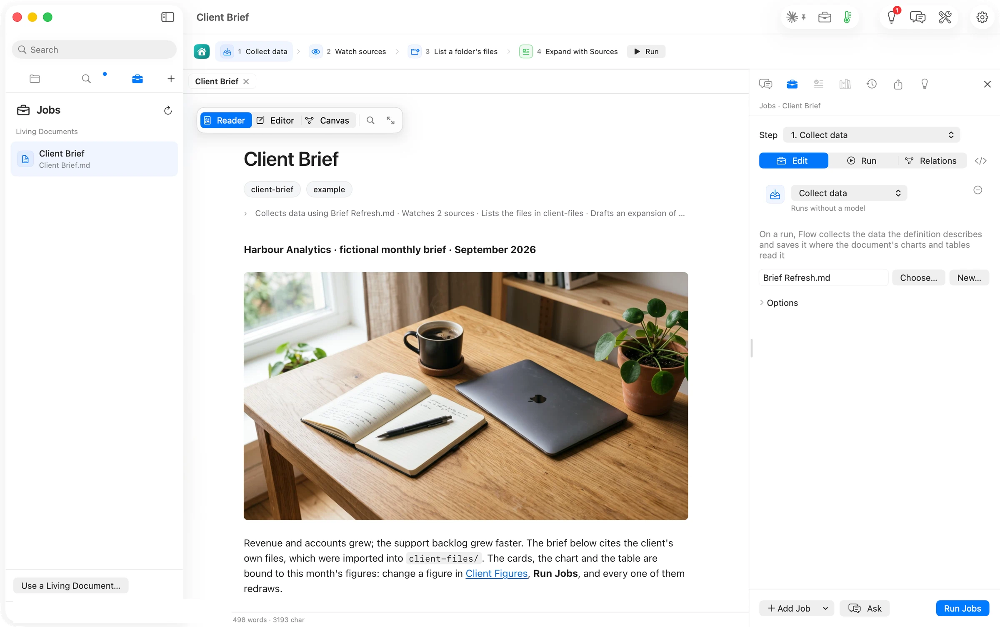

Pressing a step in the ribbon opens the Workbench on the Jobs tab, one step at a time. Step 1 collects data: it names the saved definition, *Brief Refresh.md*, says it runs without a model, and explains that on a run Flow saves the result where the document's charts and tables read it.

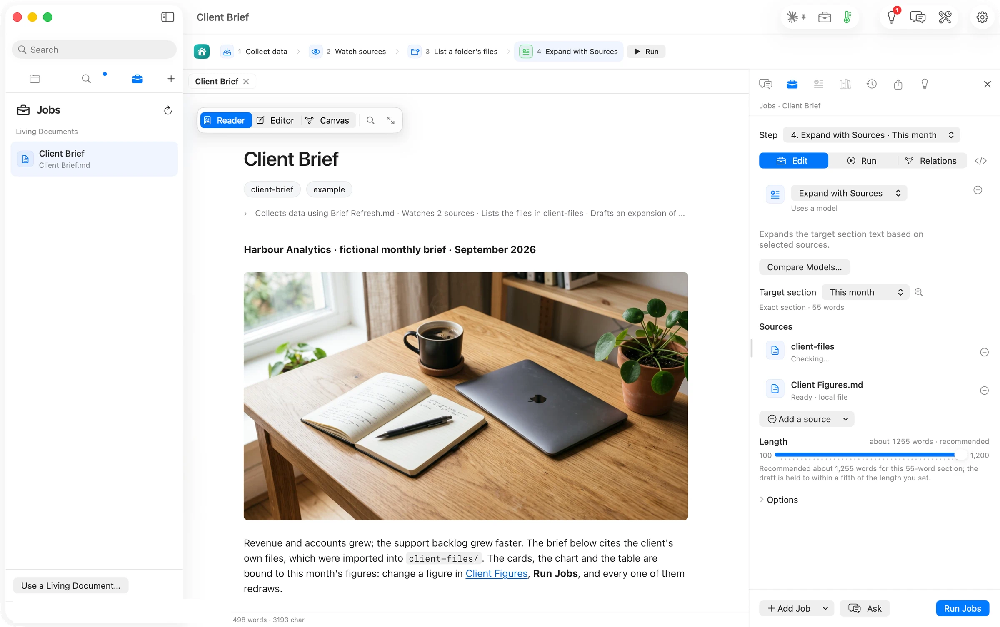

Step 4 is where the power user lives. The target is the *This month* section, 55 words; the sources are the `client-files` folder and *Client Figures*, each with its readiness; the length slider recommends about 1,255 words for a section that size; **Compare Models…** runs the same step on two models. Nothing here is hidden from the person who wants it.

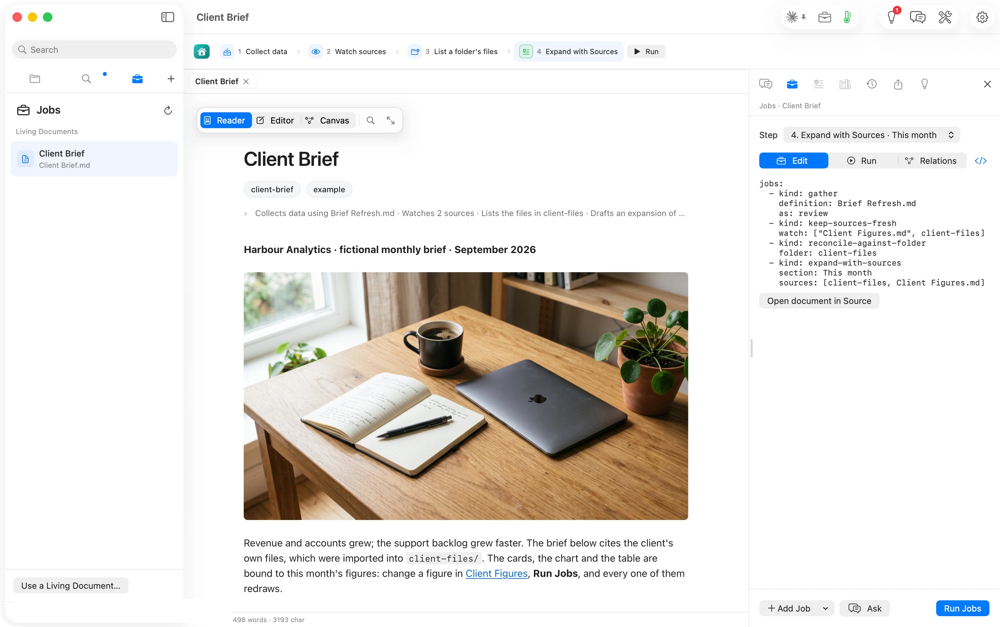

Pressing **</>** shows the declaration as text, the four jobs in the document's own front matter. The step picker above it lists them by name.

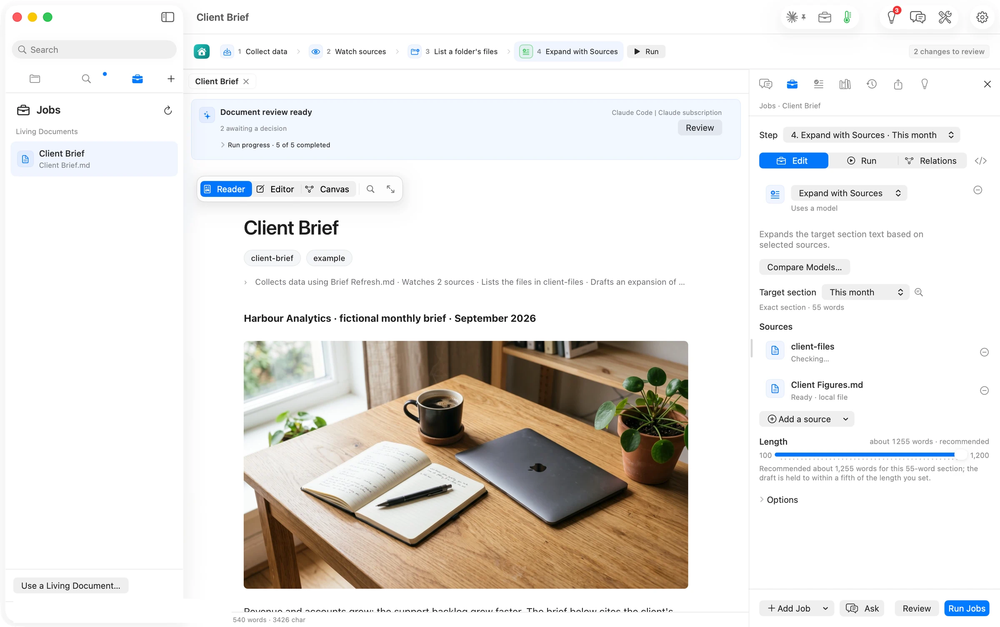

**Run Jobs**, and 71 seconds later the banner read *Document review ready · 2 awaiting a decision*. No consent sheet appeared: the run went to Claude Code on the author's subscription.

Review Changes shows the proposal in the document, highlighted, with a superscript on every cited sentence, and in the Workbench the two decisions: the expansion, *1181 words, was 55 · 3 sources cited · Claude subscription · Run by Claude Code*, proposed; and the inventory of `client-files`, applied. The draft is careful: it says which arithmetic is its own and what the sources do not say. We ticked *I accept changes*, approved, and kept the inventory.

## Level three, first pass: what the canvas shows after that run

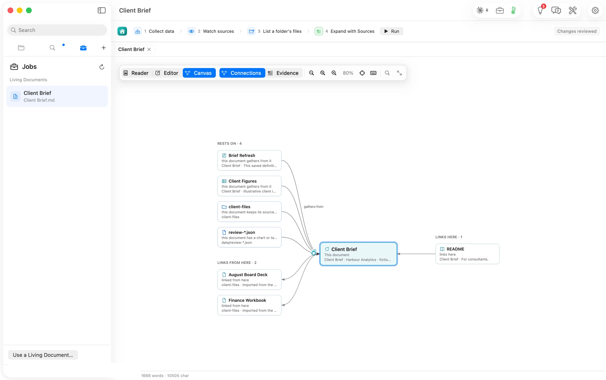

**Canvas ▸ Connections** lays the brief in the middle. To the left, *Rests on · 4*: the definition it gathers from, the figures it gathers from, the folder it keeps its sources fresh from, and the `review-*.json` capture its chart and table read. Below, *Links from here · 2*: the board deck and the finance workbook, which the new section now cites. To the right, the README that links here.

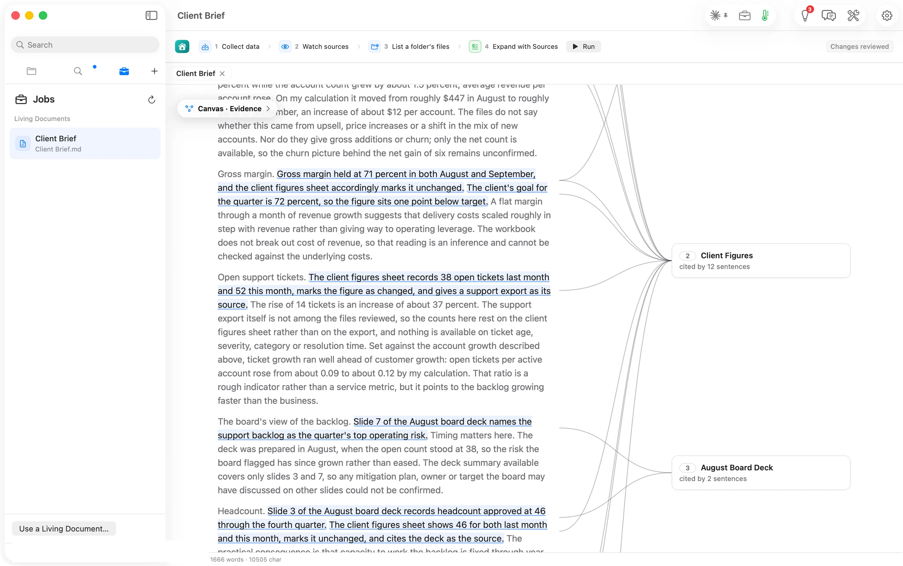

**Evidence** is enabled now that the brief cites something. Each cited sentence is underlined and joined to its source in the margin, and each source card counts the sentences that rest on it: *Client Figures · cited by 12 sentences*, *August Board Deck · cited by 2*.

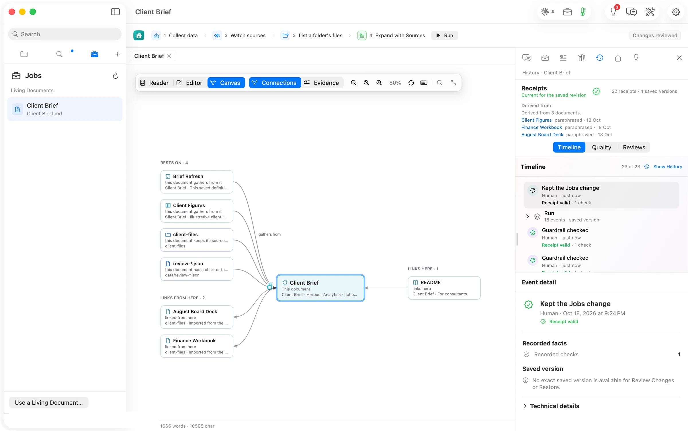

The Workbench's **History** tab says where the words came from: *Derived from 3 documents*, Client Figures, Finance Workbook, August Board Deck, each *paraphrased · 18 Oct*, with *22 receipts · 4 saved versions* and a timeline of 23 events, the run and its saved version among them. View ▸ **Show History** plays those versions back in the Reader, stepped by arrow keys or a two-finger swipe.

## Level two: the same work, asked for in one sentence

A fresh clone of the brief, four Jobs declared and nothing run.

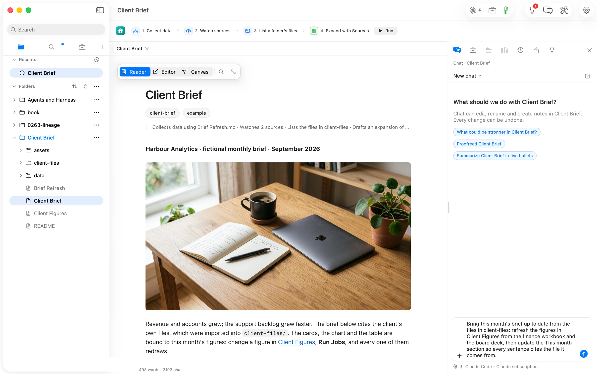

The reply came 34 seconds after the send. Chat had read *Client Figures* against the finance workbook and found revenue, accounts and margin already matched, so it left that file alone. It rewrote *This month* so every sentence ends with a link to the file it comes from, dropped a sentence of instructions that came from no file, and said plainly what it could not do: the board deck's text had not come with the message, so the headcount and the top-risk line were left as the brief already cited them. Then it offered the next step: Run Jobs so the cards and chart redraw, or Expand with Sources for a fuller draft written from the deck itself. One change card, *Edited · 1 edit · Shown in Review*, with **Undo**.

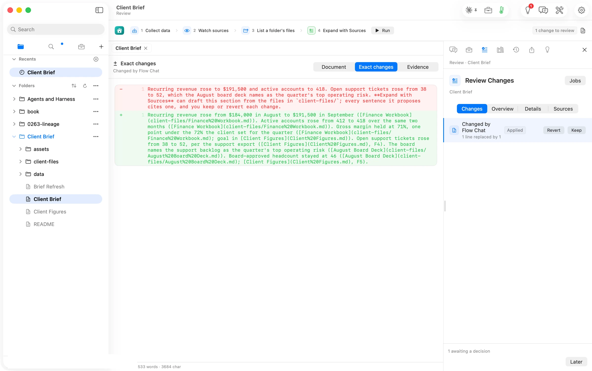

The same edit waits in Review Changes, where **Exact changes** shows the one line Chat replaced, captioned *Changed by Flow Chat*, with Keep and Revert. We kept it.

We said yes to the heavier run. Chat started Expand with Sources and told us what it would stand on: *the brief's own job settings point it at the This month section with client-files and Client Figures as sources*. Ninety-four seconds later Review Changes opened on the proposal, *1116 words added or removed; original: 90 words · Run by Claude Code*, with the month-by-month table the run drew from the figures sheet and a citation on every claim. The run Chat starts takes the same section and sources the hand-configured step declares.

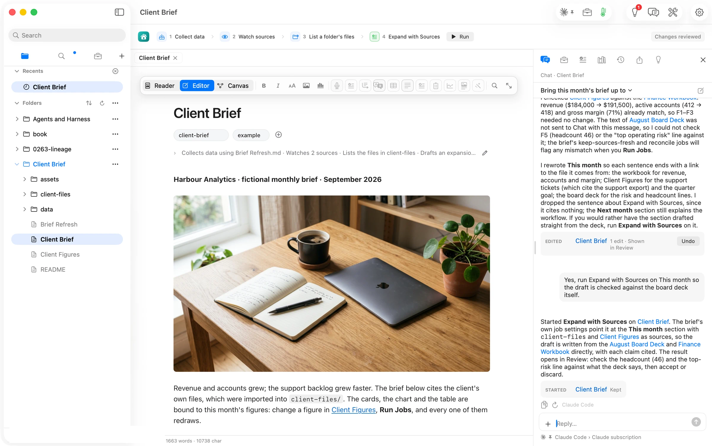

Approved, the card in Chat reads *Started · Client Brief · Kept*: the conversation keeps the record of what it set in motion and how it ended.

One more sentence asked for a picture of the client's harbour at dawn. Chat started a picture run, the banner named the provider and the model and said *usually under a minute*, and 29 seconds later Review Changes proposed the image line. Flow places a picture Chat asks for after the document's lead line; if you want it somewhere else, drag the line there once you accept it, or ask Chat to move it.

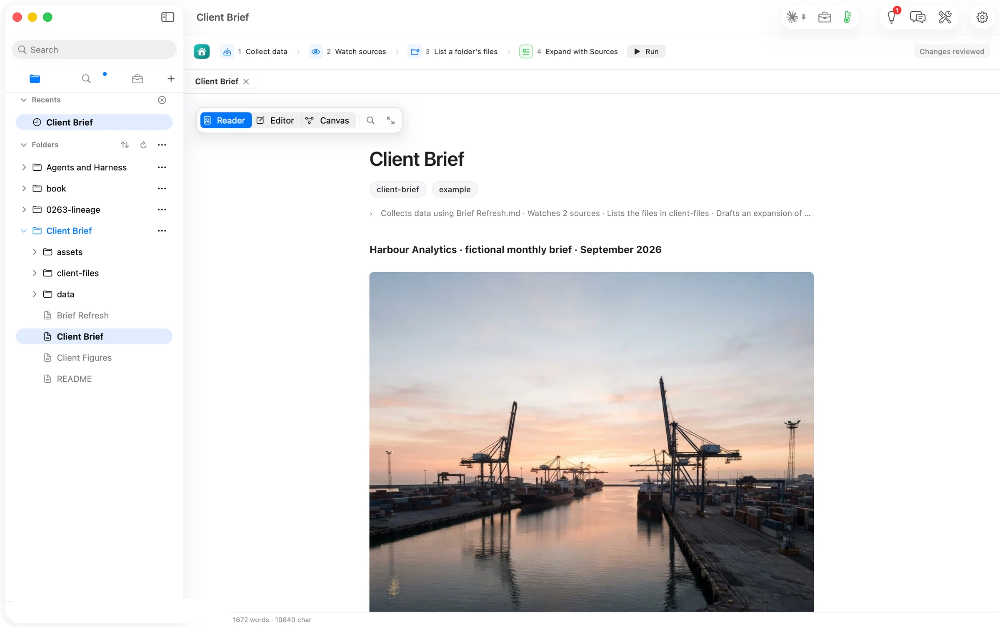

Accepted, the picture is saved into the document's `assets` folder and drawn in the Reader. It is the one run in this walk that was billed, at three cents on the author's own OpenRouter key.

## Level three, second pass: what the canvas shows after Chat

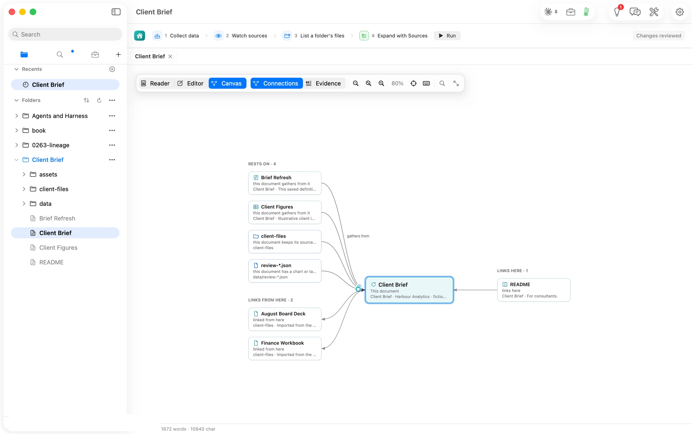

The canvas draws the same shape: *Rests on · 4*, *Links from here · 2* because Chat's sentences link the files they cite, *Links here · 1*.

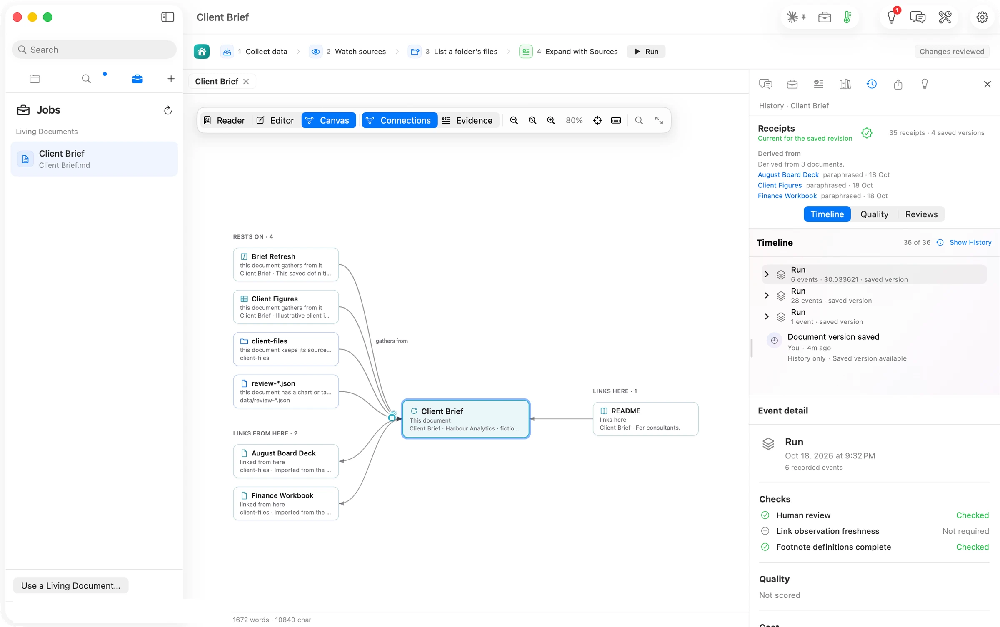

History says *Derived from 3 documents*, with *35 receipts · 4 saved versions* and a timeline of 36 events: the picture run with its cost on the line, the expansion, Chat's edit as a run of its own, and the version each one saved. The person who asked in sentences gets the same account as the person who configured every step.

## The numbers

| Figure | Value | Status and source |
| --- | --- | --- |
| Hand-configured run, Run Jobs to review ready | 71 s, 21:20:41–21:21:52 PDT | verified (clock around the press; the review file's write time) |
| The proposal | 1,181 words where there were 55; 3 sources cited | verified (the Review row read back, shot 06) |
| Step 4's recommendation | about 1,255 words for a 55-word section | verified (shot 03) |
| Chat, message to reply | 34 s, sent 21:27:10 PDT | verified (clock around the send; the review file's write time) |
| Chat's direct change | 1 edit to the brief, 0 to Client Figures | verified (the change card; Client Figures unchanged on disk) |
| Chat-started Expand with Sources | 94 s, sent 21:28:51 PDT; 1,116 words added or removed, original 90 | verified (the Review row read back, shot 13) |
| Chat-started picture | 29 s, sent 21:31:00 PDT; 1024×1024 | verified (the receipt's recorded time and picture size) |
| Spend | $0.0336 for the picture (OpenRouter, google/gemini-3.1-flash-lite-image, reported basis); every text run on a Claude subscription, marginal cost assumed $0 | verified (the run's receipt; the route line) |
| Canvas after the hand run / after Chat | Rests on 4 · Links from here 2 · Links here 1, both times | verified (shots 07, 17) |
| Evidence after the hand run | Client Figures cited by 12 sentences; August Board Deck by 2 | verified (shot 08) |
| History after the hand run | Derived from 3 documents; 22 receipts, 4 saved versions, 23 events | verified (shot 09) |
| History after Chat | Derived from 3 documents; 35 receipts, 4 saved versions, 36 events | verified (shot 18) |
| Decisions after the hand run | 2 awaiting a decision; run progress 5 of 5 | verified (shot 05) |
| Steps that needed anything outside Flow | 0 | verified (journal) |

## More Flow walks

- [Diagrams that draw anywhere](/flow/paths/diagrams-draw-anywhere/)
- [A checklist you can sign, inside the document](/flow/paths/a-checklist-you-can-sign/)
