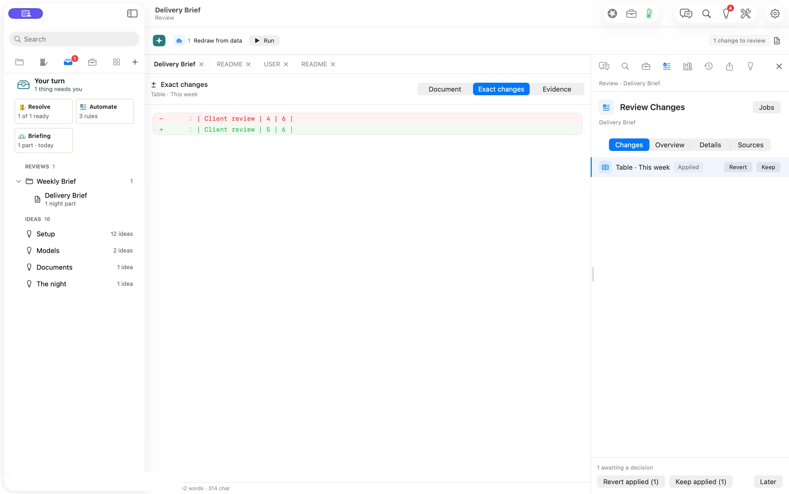

**Flow puts waiting decisions together and takes you to the exact change.** A Job can refresh a figure from the same source every week. Your turn shows which documents have something to decide and lets you handle the routine updates with rules you can inspect. AI does the routine part. You sign off.

> “Take me to the part I need to decide. I’ve already read the rest of the brief.”
> *Illustrative scenario.*

## Decide a change

1. Open **Your turn** (⌘7). Open the document under **Reviews**.
2. In **Review Changes**, select the table change and use **Exact changes** to compare the old and new line.
3. Press **Keep** or **Revert**. The queue updates when you decide.

The brief’s **Redraw from data** Job read the saved delivery report. Client review moved from four delivered to five, with six still planned. We kept the applied table change, and Your turn returned to **Nothing needs you**.

## Handle the familiar updates

In Flow Pro, **Resolve** keeps the eligible updates shown as ready at the time you press it. **Automate** explains what each rule would keep and what still needs you. Use it to inspect and refine a rule before deciding what to do. When Flow learns a rule, it offers **Undo** for the rule.

## Evidence

| What we checked | Result |
| --- | --- |
| Waiting review | Verified. One table update appeared, then the queue cleared after the manual Keep. |
| Changed figure | Verified in Exact changes. Delivered went from 4 to 5. Planned stayed at 6. |
| Model cost | Verified. The local refresh and manual decision used no model and showed $0.00 in session spend. |
| Resolve and Automate | Verified separately on the accepted Pro release review. The shots show the queue and manual review. |
